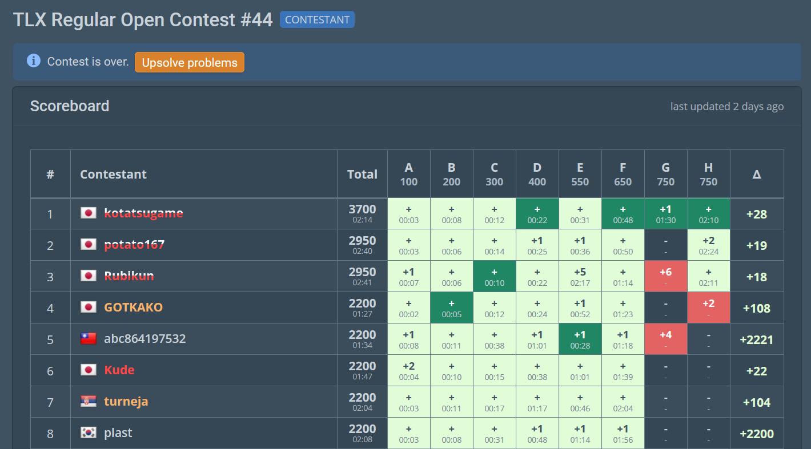

# TLX Predictor
A lightweight userscript that predicts live rating changes on the competitive programming platform [TLX](https://tlx.toki.id)

## Installing
1. Install a userscript extension [Tampermonkey](https://www.tampermonkey.net/) or [Violentmonkey](https://violentmonkey.github.io/)
2. Install **TLX Predictor** from:
    * **[Greasy Fork](https://greasyfork.org/en/scripts/604898-tlx-predictor)**
    * **[Github](https://raw.githubusercontent.com/bramar2/tlx-predictor/refs/heads/main/userscript/script.js)**
    
## How does it work?
It intercepts scoreboard fetch data while on the `/contest/scoreboard` page and uses this information to calculate the rating predictions based on [TLX's official rating system](https://tlx.toki.id/ranking/rating-system]).

This mostly works, but some TLX contests are only rated for Div 2 or Div 1. TLX doesn't currently provide a public API for the "rated range", therefore the userscript uses a heuristic by intercepting the contest description data in order to determine a contest's "rated range" using Regex.

## License
Licensed under the MIT License.